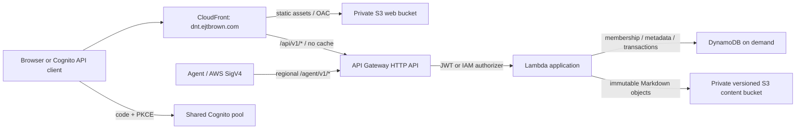

# Architecture and design decisions

## Request paths

The deployed web origin is proposed as `dnt.ejtbrown.com`, in account `264702148921`, with regional resources in `us-east-2` and the CloudFront certificate in `us-east-1`. These settings are editable in `config/deploy.json`. No API response is cached. CloudFront rewrites only `/auth/callback` to the static application; API errors are never replaced by the SPA.

The implementation is TypeScript, React/Vite, the AWS SDK v3, and CDK. One Lambda owns the initial API to keep deployment and transactions straightforward. Its service layer is separate from HTTP authentication and the storage adapters. The local runner and tests reuse the service layer with a local store; the deployed Lambda always uses DynamoDB and S3.

## Why DynamoDB plus S3

Use DynamoDB as the authoritative record store for project metadata, memberships, work items, revision pointers, idempotency results, and audits. Use S3 for immutable Markdown bodies. DynamoDB on-demand has request-based capacity billing instead of an always-running database instance; storage, backups, logs, and network traffic still incur charges. [AWS on-demand mode](https://docs.aws.amazon.com/amazondynamodb/latest/developerguide/on-demand-capacity-mode.html).

S3 alone can store documents efficiently, but coordinated membership updates, ticket-number allocation, and conditional metadata changes would require more application-level coordination. This workload's reads are naturally bounded by a known project, user, or object identifier. DynamoDB transactions keep the coordination in one service. A relational service such as Aurora DSQL would be worth revisiting if ad-hoc joins and reporting become central; it would change the storage adapters and query model. The initial implementation avoids that additional dependency.

This is deliberately more than a disposable S3 index: losing DynamoDB loses permissions, counters, work items, and the authoritative revision graph. Back up both stores. AWS documents both the S3 pointer pattern and the lack of a transaction spanning S3 and DynamoDB. [Large-item storage guidance](https://docs.aws.amazon.com/amazondynamodb/latest/developerguide/bp-use-s3-too.html).

## Data keys

All records have `pk`, `sk`, `version`, and `value`. No secondary indexes or scans are needed for initial access patterns.

| Partition key | Sort key | Record / access |
| --- | --- | --- |
| `PROJECT#ROOT` | `META` | Project, sequence, administrator count, mutation version |
| `PROJECT#ROOT` | `ITEM#000000000001` | Work item by project ordinal |
| `PROJECT#ROOT` | `MEMBER#<principal>` | Project membership listing |
| `PRINCIPAL#<principal>` | `PROJECT#ROOT` | Authorization and user's project listing |
| `PROJECT#ROOT` | `DOC#User#<uuid>` | Current document metadata |
| `PROJECT#ROOT` | `REV#User#<uuid>#000000000001` | Immutable revision metadata |
| `PROJECT#ROOT` | `AUDIT#<timestamp>#<uuid>` | Mutation actor, time, action and target |
| `IDEMP#<sha256(actor,path,key)>` | `RESULT` | Request digest and successful response |

A project always exposes all three logical trees, including empty trees. Documents store a same-tree parent UUID; work items store same-project parents of the required type. Project slugs are immutable uppercase keys, 2–10 alphanumeric characters beginning with a letter. The single ordinal namespace gives Jira-like display IDs without claiming Jira API compatibility.

Memberships are written in both access directions in the same transaction. Authorization reads are strongly consistent. The project row is read before membership and acts as a common conditional-write lock for project mutations, preventing concurrent parent/membership changes and administrator-count races. This intentionally serializes writes within one small-team project. If contention becomes significant, split locks by invariant and introduce targeted indexes; do not remove the checks without preserving those invariants.

## Write protocol

1. Authenticate the request and read project membership.
2. Validate the body, hierarchy, role, and required `If-Match` version.
3. For POST, look up the actor/path/idempotency key. A matching request returns its original response; a different body gets `409`.
4. For changed Markdown, write a new unique immutable S3 object first.
5. In one DynamoDB transaction, write the record, project lock/counter, authorization condition, audit event, revision metadata when applicable, and idempotency record when applicable.
6. Return success only after the transaction commits.

A storage failure before step 5 cannot create a dangling content pointer. A failed or ambiguous transaction after an S3 write may leave an unreferenced object. These objects are harmless and retained in v1. No lifecycle rule deletes current content or historical revisions. Future garbage collection must reconcile all committed revision references and wait out in-flight writes; it must not delete solely based on age.

DynamoDB condition failures retry up to five attempts with jitter. Stale caller versions return `412`; missing versions return `428`. A contended operation can return `409`; clients should reread before modifying an existing item, and reuse the same idempotency key/body when retrying a create. Deduplication records do not expire automatically. Reads/lists during concurrent edits are individually strongly consistent, but a multi-request paginated listing is not a snapshot.

## Authentication and authorization

People use the existing shared Cognito pool and a dedicated **public** dnt app client with exact HTTPS redirect/logout URLs and authorization-code + PKCE. API Gateway verifies token signatures, issuer, audience and `openid` scope. Lambda additionally requires `token_use=access`, the exact `client_id`, unexpired claims, and a nonempty subject. ID tokens and arbitrary tokens from other applications in the shared pool cannot authorize dnt operations. [HTTP API JWT validation](https://docs.aws.amazon.com/apigateway/latest/developerguide/http-api-jwt-authorizer.html).

Agents use the separate IAM-authorized route namespace. The handler accepts only API Gateway's trusted authorizer context, maps registered STS role sessions to stable IAM role ARNs, and applies the same membership checks. The production handler never trusts local development headers. Lambda invoke permissions are granted to API Gateway, not anonymous callers.

Project roles are inherited `User < Maintainer < Administrator`. Unknown and unauthorized projects return `404`. An authenticated operator can create projects but cannot bypass their membership rules. Project grants are read from DynamoDB on each request rather than embedded in a long-lived Cognito claim. A request already in flight can finish after a concurrent revocation; mutations condition-check the membership and project lock at commit.

The static S3 bucket contains only application assets and public client configuration. The separate content bucket has no CloudFront origin and no public URLs. Document content is returned after authorization. Raw HTML is not rendered in Markdown. Production CSP also blocks external images, avoiding automatic external requests from project content. The browser retains access tokens only in memory and stores temporary OAuth state/verifier in session storage.

## Cost and operational boundaries

No VPC, NAT gateway, EC2, RDS instance, provisioned Lambda concurrency, or search cluster is created. Compute and request charges primarily follow usage. Persistent charges remain for S3/DynamoDB storage, DynamoDB recovery, logs, Route 53, and any shared Cognito plan. CodeBuild is on demand. This is a cost-conscious architecture, not a promise of a particular monthly bill; no regional price estimate has been invented.

Data has CloudFormation retention, DynamoDB deletion protection and point-in-time recovery, S3 versioning, and stack termination protection. Those controls do not replace a tested restore procedure. Logs retain 30 days and omit request bodies/tokens. An API server-error alarm is created without notification subscriptions; attach the team's operational destination before depending on it for alerts.

The deployment tooling owns the CodeBuild runner, GitHub role, CloudFormation execution policy, and runtime permissions boundary. Runtime roles are restricted to dnt resources. Infrastructure permissions are scoped by resource names where possible; API Gateway and CloudFront creation/management require broader service permissions in this first version. Treat deployment access as privileged infrastructure access. The tooling stack and its policies are administrator-owned, not part of the routine application deployment.

The checked-in CDK release bundles a `minimatch` version flagged by `npm audit` for a [moderate build-time denial-of-service advisory](https://github.com/advisories/GHSA-g3hv-75wg-m249). It is not in the browser or Lambda bundle. CDK bundles this dependency, so an npm override does not replace it. Update CDK when its bundled dependency is fixed; do not downgrade infrastructure libraries solely to make an audit report empty.
